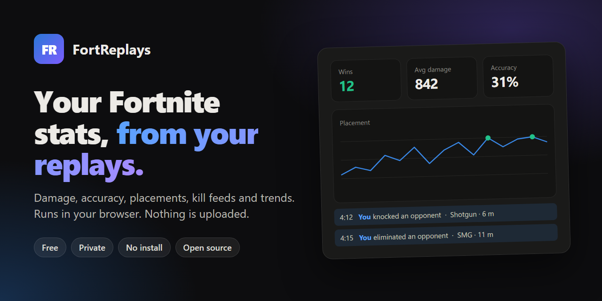

<p align="center"></p>

<h1 align="center">FortReplays</h1>

<p align="center">
  <b>Fortnite stats from your own replay files, in your browser.</b><br>
  <a href="https://fwsoapy.github.io/fortreplays/"><b>Open FortReplays →</b></a>
</p>

Fortnite saves a `.replay` file for every match you play. FortReplays reads those files and shows
your damage, accuracy, placements, the full kill feed and how you are trending over time.

Everything happens inside your browser tab. Your replays are never uploaded, there is no account,
and the site works offline once it has loaded.

## Using it

1. Open **[fwsoapy.github.io/fortreplays](https://fwsoapy.github.io/fortreplays/)**.
2. Press **Add replays**, then **Choose Demos folder** and pick
   `%LOCALAPPDATA%\FortniteGame\Saved\Demos`. You can also drag files or the whole folder onto the page.
3. That's it. A hundred replays import in under a second.

If the folder is empty, turn on **Record Replays** in Fortnite's settings.

To use it with no internet at all, save the page (Ctrl+S) or download
[`docs/index.html`](docs/index.html) and double-click it. It is one self-contained file.

## What you get

- **Overview.** Wins, top 10s, average placement, eliminations, damage, accuracy and time played,
  with a placement chart, a damage chart, your personal bests, a breakdown by mode and a day-by-day
  session list. Filter by the last 7 days, 30 days or all time.
- **Matches.** Every replay you imported, searchable and sortable, with filters for wins, top 10s
  and matches that have a stats block.
- **Match.** Your full stats block (damage dealt and taken, accuracy, eliminations, assists,
  structure damage, materials, distance, revives), the placement, your squad, and the whole lobby's
  kill feed with you and your teammates highlighted. Use ← and → to step through matches.
- **Backups.** Export your history to a JSON file and import it on another browser or PC.

## What a replay can and cannot tell you

| | |
|---|---|
| **Exact** | Your damage, damage taken, accuracy, eliminations, assists, materials, distance and placement, read from the stats block Fortnite writes into your replay. The whole lobby's kill feed, with times and distances. |
| **Guessed** | Your teammates. The browser version cannot decode the part of the file that holds team numbers, so it suggests likely teammates from the kill feed and you confirm them once. Weapon names are guessed from kill ranges, and you can rename them in Settings. |
| **Not in the file** | Your teammates' damage. Fortnite only records the damage of the player whose replay it is. |

Games you leave before they end for you usually have no stats block. They still import with their
placement and kill feed.

## Privacy

- Replays are read with the browser's File API and parsed in JavaScript on your machine.
- Matches are stored in your browser's IndexedDB for this site. Nothing is sent anywhere.
- The one optional exception: if you add a name-lookup API key in Settings, pressing
  **Look up names** on a match sends that match's account ids to the lookup service. With no key,
  the app makes no network requests at all.

## How it works

A `.replay` file is a header followed by chunks. The chunk payloads are AES-256-ECB encrypted
with a key stored in plain text in that same header. FortReplays reads the event chunks, which
carry the stats block, the team placement and every elimination.

```
docs/index.html        the built site (GitHub Pages serves this folder)
standalone/
  replay.js            AES-256, the Unreal binary reader and the replay parser
  app.js               storage, aggregation, account and squad detection, backups
  ui.js                the screens and charts
  site.css             styles for the site build
web/styles.css         shared base styles
build_html.py          inlines everything into one HTML file
assets/                source for the social preview image
```

No frameworks and no dependencies. To rebuild after editing anything in `standalone/`:

```bash
python build_html.py
```

That writes `docs/index.html` and a local copy, `FortReplays.html`.

### Desktop version

The repo also holds an older desktop build (`fortreplays.py`, `server.py`, `replay/`,
`extractor/`). It runs a small local server plus a .NET helper built on
[FortniteReplayReader](https://github.com/Shiqan/FortniteReplayDecompressor), which decodes the
network stream and so gets exact teams and real player names. It is Windows-only and needs the
.NET SDK to build, which is why the website is the main version.

## Troubleshooting

**A replay fails to import.** It is probably from a much older Fortnite build, or Fortnite was
still writing it.

**My matches disappeared.** They are stored per browser and per site. Clearing site data or
switching browsers starts you from empty, so export a backup from Settings now and then.

**The wrong player is highlighted as me.** Paste your Epic account id under Settings → Your account.

## License

[MIT](LICENSE). Not affiliated with or endorsed by Epic Games. Fortnite is a trademark of Epic Games, Inc.
